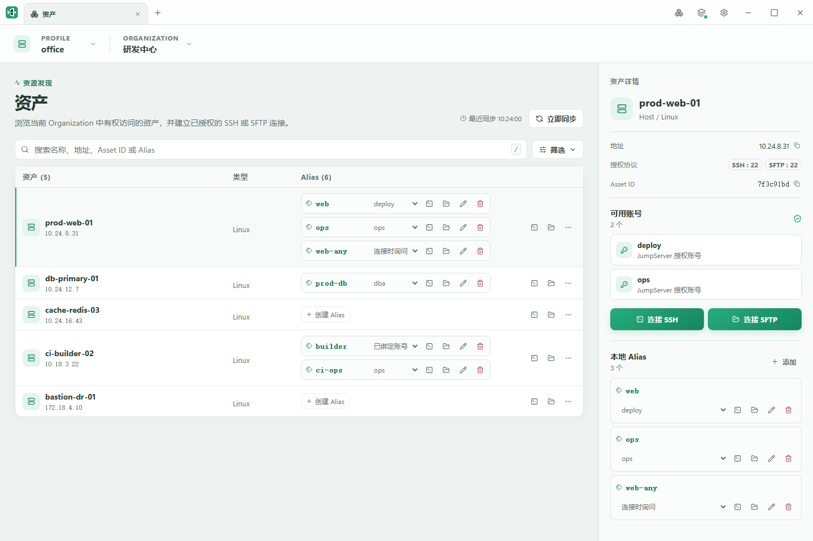
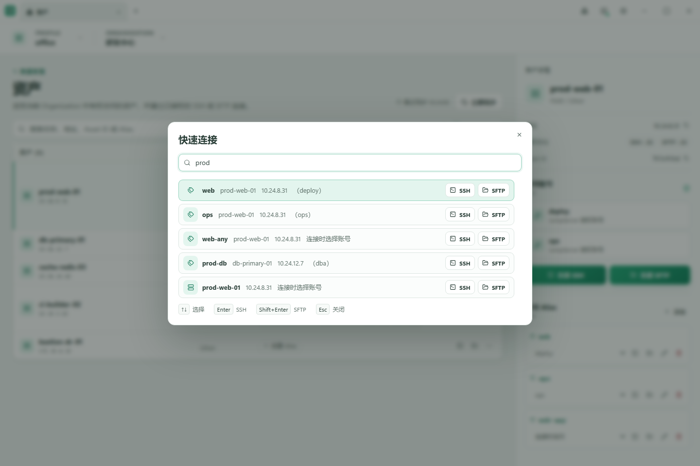
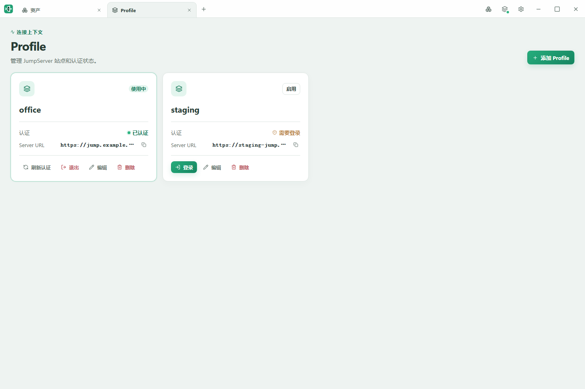
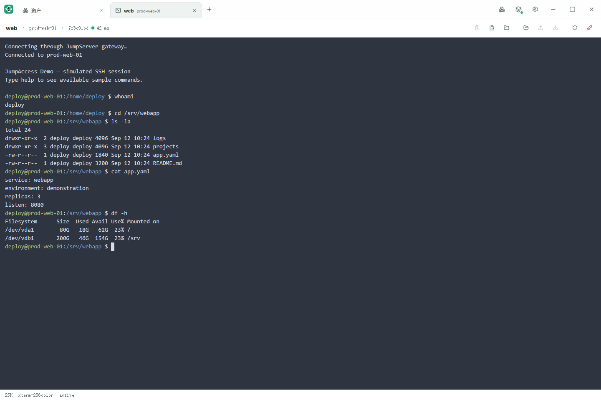
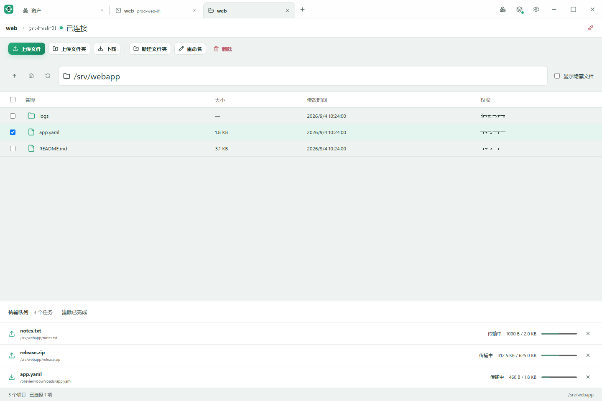
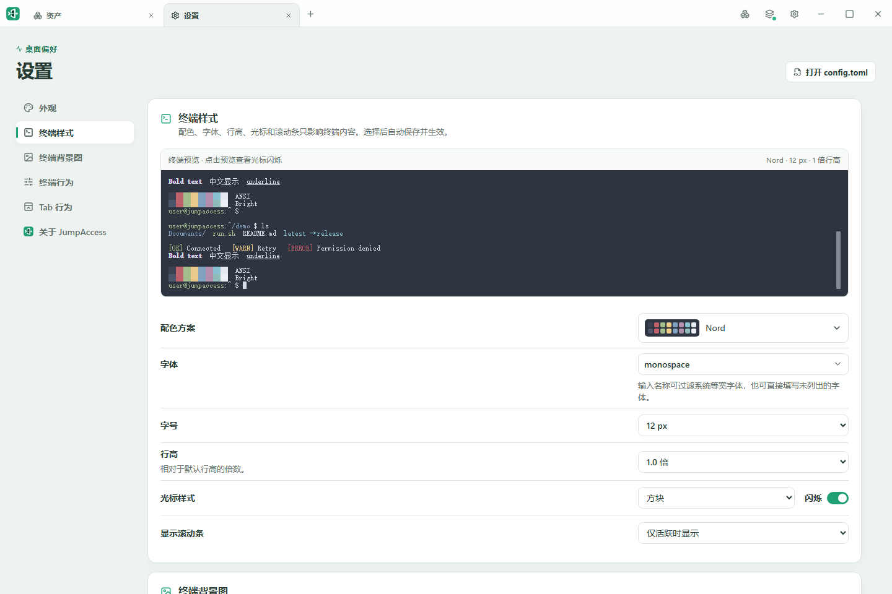

# JumpAccess

[](LICENSE)

JumpAccess 是一个面向 [JumpServer](https://github.com/jumpserver/jumpserver)（参考版本 `v4.1.6`）的独立访问工具项目。旨在接入 JumpServer 的环境下，尽可能地维持 SSH CLI / 第三方终端客户端的原生使用体验。

项目包含两个入口程序，复用同一套底层：
- 纯 Golang 编写的命令行程序 `jumpctl`
- 桌面 GUI，基于 Wails 2 + React.js

本项目**由 AI Agent 编码实现**，开发者负责提需求、产品设计、确定业务逻辑与边界条件、验收测试，但通常不直接阅读和修改源码。

## 项目目标

- 不依赖 JumpServer 桌面 Client，独立完成浏览器 OAuth 登录和 Token 生命周期管理。
- 以 SSH 客户端方式直接连接远程 Asset。
- 作为通用 SSH `ProxyCommand` 被兼容的终端或 SSH 客户端调用，不与某个具体终端产品耦合。
- 通过 TOML 管理多个 JumpServer Profile 以及 Asset 别名等非敏感配置。
- 支持 Windows 和 macOS，并以仅当前用户可访问的 Profile 独立文件保存 OAuth Token。

首个兼容性参考基线是 JumpServer Client `v4.1.6` 所使用的协议和接口。它是分析参考，不表示本项目依赖该桌面 Client 才能运行。

## 界面预览

<table>
  <tr>
    <td width="50%" align="center">
      <br>
      <sub><b>资产与别名</b></sub>
    </td>
    <td width="50%" align="center">
      <br>
      <sub><b>快速连接</b></sub>
    </td>
  </tr>
  <tr>
    <td width="50%" align="center">
      <br>
      <sub><b>多 Profile 管理</b></sub>
    </td>
    <td width="50%" align="center">
      <br>
      <sub><b>SSH 终端</b></sub>
    </td>
  </tr>
  <tr>
    <td width="50%" align="center">
      <br>
      <sub><b>SFTP 文件管理</b></sub>
    </td>
    <td width="50%" align="center">
      <br>
      <sub><b>终端样式</b></sub>
    </td>
  </tr>
</table>

## 安装

## 安装 CLI jumpctl

需要 Go 1.25 或更高版本。

使用 Go 安装最新发布版本：

```powershell
go install github.com/cmstar/jumpaccess/cmd/jumpctl@latest
```

如果 clone 了源码，可直接从源码安装：

```powershell
go install ./cmd/jumpctl
```

若没有 Go 环境，可以从发布页直接下载，参考下面的“下载 GUI 客户端”章节。下载后，若需要全局可用，需自行添加到 `PATH` 环境变量。

验证安装：

```
jumpctl version
```

## 下载 GUI 客户端 jumpaccess

在 [发布页](https://github.com/cmstar/jumpaccess/releases) 下载对应版本的客户端。
- Windows 提供 X64 版本。
- macOS（darwin）提供 X64 和 ARM 版。

## 本地开发、测试与构建

### 开发环境

CLI 与 GUI 共用 Go 1.25 或更高版本，具体依赖以 `go.mod` 为准。

GUI 额外需要：

- Node.js 24
- [Wails 2](https://wails.io/)

安装 Wails 2 CLI：

```powershell
go install github.com/wailsapp/wails/v2/cmd/wails
wails doctor
```

如果仅做一次性构建，也可以不安装 Wails CLI，直接使用 `go run "github.com/wailsapp/wails/v2/cmd/wails"` 代替 `wails` 命令。

### 本地运行与测试 CLI

本地测试和运行：

```
go test ./...
go vet ./...
go run ./cmd/jumpctl
```

### 构建 CLI

```powershell
go build -trimpath ./cmd/jumpctl
```

### 本地运行、测试与构建 GUI

安装前端依赖：

```powershell
cd cmd/jumpaccess
npm --prefix frontend ci
npm --prefix frontend test
```

本地运行（仍在 `cmd/jumpaccess` 目录）：

```
wails dev
```

构建：

```
wails build
```

构建结果默认输出在 `cmd/jumpaccess/build/bin` 目录：Windows 为 `jumpaccess.exe`，macOS 为 `JumpAccess.app` 应用包。平台检查和发布约定见[开发说明](docs/development.md)。

## 使用 jumpctl

首次使用请跟随 [CLI 入门指南](docs/manual/cli-quick-start.md)，从安装和浏览器认证开始，逐步完成资源查询、别名绑定和 OpenSSH 连接。

完整命令和参数见 [CLI 命令参考](docs/cli.md)，也可以运行 `jumpctl --help` 或 `jumpctl <command> --help` 查看。

通用 OpenSSH 配置示例（`web` 可以是已绑定唯一 Asset 和 Account 的 Alias）：

```sshconfig
Host production-web
    HostName web
    User jumpaccess
    ProxyCommand jumpctl proxy %h
```

`auth login` 默认使用手工回调：浏览器完成授权后，不要点击确认页的“确认”，而是复制页面中的 `jms://` 链接或浏览器地址栏的完整确认页 URL，粘贴到等待中的终端。`--manual` 可显式固定这一行为，供官方客户端仍占用协议或系统不允许注册协议时使用。

本机没有可用浏览器时，运行 `jumpctl auth login --profile work --no-browser`。程序只打印授权地址并等待粘贴回调，可把地址复制到另一台能访问 JumpServer 的电脑上完成授权，再把回调粘贴回原终端。无需同时指定 `--manual`；保留原登录进程，Token 会保存在运行 CLI 的机器上。当前平台支持仍为 Windows 和 macOS，Linux 适配尚未完成。

桌面 GUI 只要保持运行，就会按配置周期检查所有已保存 Refresh Token 的 Profile，并在 Access Token 临近过期时自动刷新；运行期间新增登录无需重启 GUI。Refresh Token 已过期或被撤销时仍需重新登录。

`proxy` 模式不打开浏览器，也不提示选择 Account。缺少登录、Refresh Token 失效、目标或 Account 不唯一、上游主机尚未信任时，进程会在 SSH banner 之前失败，只向 stderr 写入可操作错误并返回非零状态。先运行 `jumpctl auth login` 完成授权；未知上游 gateway 需要先用 `jumpctl ssh` 进行一次人工指纹确认。

## 桌面 Tab 切换

Windows 使用 `Ctrl+Tab` 切换到右侧下一个 Tab，`Ctrl+Shift+Tab` 切换到左侧上一个 Tab；macOS 使用相同的 `Control+Tab`、`Control+Shift+Tab`。按 Tab 栏当前顺序首尾循环，支持持续按住 Control 连按 Tab，也支持长按；只有一个 Tab 时保持原位。

焦点在 SSH 终端或输入框内也可切换，切换到 SSH 后可继续输入。弹窗打开期间暂停切换；终端全屏时先恢复窗口再切换，恢复失败则保持当前 Tab。组合键不会发送给远端，普通 `Tab` 和 `Shift+Tab` 保留原行为。这是桌面客户端的快捷键，浏览器演示中的实体按键可能由外部浏览器优先处理。

## SSH 终端全屏

在 SSH Tab 按 F11 切换全屏，Windows 也支持 Alt+Enter ；再按一次恢复原窗口位置、大小或最大化状态。全屏隐藏 Tab 栏和底部状态栏，鼠标移到顶部中央可显示会话名称和退出按钮。Esc 仍用于终端操作。

“设置 → 终端行为 → 全屏时隐藏工具栏”默认开启；关闭后，全屏保留 SSH 工具栏、传输进度和取消按钮。

## 参与贡献

欢迎反馈问题、提出功能建议和提交 PR。开始前请阅读[贡献指南](CONTRIBUTING.md)；[新建 Issue](https://github.com/cmstar/jumpaccess/issues/new/choose) 时可选择中文或英文表单，PR 模板任选一种语言填写即可。

## 文档索引

- [用户指南](docs/manual/README.md)
  - [CLI 入门指南](docs/manual/cli-quick-start.md)
  - [在 SSH 终端内使用 sz/rz 命令上传/下载文件](docs/manual/file-transfer.md)
- [贡献指南与协作流程](CONTRIBUTING.md)
- [Agent 工作入口](AGENTS.md)
- [架构说明](docs/architecture.md)
- [业务说明](docs/domain.md)
- [开发说明](docs/development.md)
- [CLI 命令参考](docs/cli.md)
- [项目规范与索引](docs/standards/README.md)
- [当前与历史决策索引](docs/decisions/README.md)
- [需求、设计与历史版本索引](docs/specs/README.md)
- [操作手册与索引](docs/runbooks/README.md)

安装、开发环境、运行命令或发布方式变化时更新本页；各文档的内容归属和维护时机见[文档维护](docs/development.md#文档维护)。

## 自动 Release

推送符合 `vX.Y.Z` 或 `vX.Y.Z-prerelease` 的 Git tag 会触发 [Release 工作流](.github/workflows/release.yml)。

```powershell
git tag v0.1.0
git push origin v0.1.0
```

工作流执行成功会自动生成一个 Release，并根据当前版本与上一版本（tag）的差异，生成发布说明。

产物包括 Windows 和 macOS（amd64+arm64）的 CLI/GUI 程序，每个都可以独立下载。

## 安全说明

不要把账号密码、Access Token、Refresh Token、Cookie、私钥或其他真实凭据写入仓库。真实 JumpServer 账号只用于开发者本机的手工 smoke test；常规自动化测试应使用模拟服务和脱敏 fixture。

OAuth 凭据以每个 Profile 一个 JSON 文件的方式保存在应用目录的 `credentials` 子目录。文件名由 Profile 标识稳定派生，不直接使用或改写 Profile 名；Windows 使用仅当前用户和 `SYSTEM` 可访问的受保护 DACL，macOS 使用当前用户所有的 `0700` 目录和 `0600` 文件。文件内容包含 Access Token 和 Refresh Token，应像 SSH 私钥一样保护，不能复制、同步或提交到仓库。

Windows Credential Manager 或 macOS Keychain 仅用于保存 ProxyCommand 代理的稳定 Ed25519 host key，不参与 OAuth Token 的读取或写入；包含 macOS Keychain 后端的正式构建需要启用 CGO 并链接系统 Security framework。

首次直接连接某个 JumpServer SSH gateway 时，`jumpctl ssh` 会显示 SHA-256 主机密钥指纹并要求明确确认；信任记录保存在同一 JumpAccess 应用目录的 `known_hosts`。主机密钥变化不会自动接受。

ProxyCommand 存在两层独立的主机信任：外部 SSH 客户端看到的是 JumpAccess 本地代理的稳定 Ed25519 host key，该私钥保存在操作系统凭据存储；JumpAccess 自己仍使用上述 `known_hosts` 严格验证上游 JumpServer gateway。

## 演示模式与截图生成工具

浏览器演示复用桌面客户端的界面，不需要 Go、JumpServer 账号或服务器。需要 Node.js 24，在仓库根目录执行：

```powershell
npm --prefix cmd/jumpaccess/frontend ci
npm run demo
```

打开终端提示的本地地址（默认 `http://127.0.0.1:3001`）。顶部可切换已配置环境、首次使用和登录过期场景，点击“重置演示”或刷新页面恢复初始数据。Profile、Alias、偏好和模拟文件操作仅保存在当前页面的内存中，不读取正式配置、Token 或本机文件，也不连接真实服务器。

- SSH 终端输入 `help` 查看示例命令，如 `ls`、`pwd`、`df -h`、`cat app.yaml`；只返回预设结果。
- 模拟登录无需浏览器授权，在回调输入框填写 `demo` 即可。
- SFTP 上传使用预置样例文件，支持目录操作、同名冲突、取消和重试；模拟下载不写入本机磁盘。
- 原生窗口控制、打开配置文件、背景图文件选择和 ZMODEM 尚不提供演示。此入口为浏览器演示，发布的桌面程序暂不提供 `--demo` 参数。

需要生成截图时，也在仓库根目录手动执行（首次使用需先安装上述前端依赖和截图浏览器）：

```powershell
npm exec --prefix cmd/jumpaccess/frontend -- playwright install chromium
npm run screenshots
```

脚本会自行启动并关闭本地演示服务和无界面浏览器。图片统一输出到仓库的 `docs/screenshots` 目录；不同系统的字体渲染可能略有差异。

截图包含[快速连接搜索结果](docs/screenshots/quick-connect.png)：打开快速连接，输入 `prod`，展示匹配的多个别名和资产、登录账号及 SSH/SFTP 入口。

截图不在 Agent 工作流程中，UI 发生变更后，需人工执行截图命令，或主动告知 Agent 执行截图，否则不会自动生成新的UI截图。
