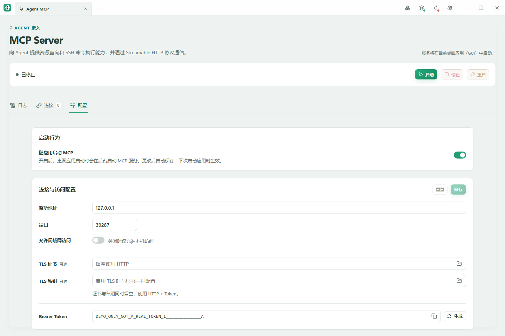
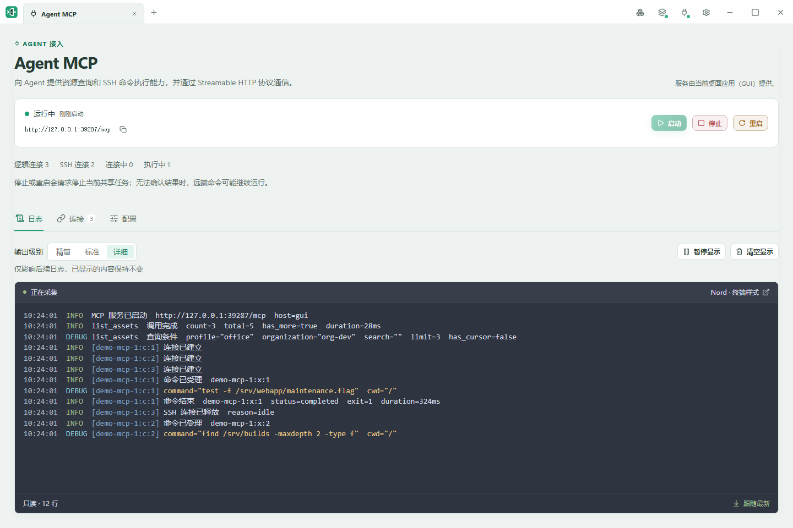
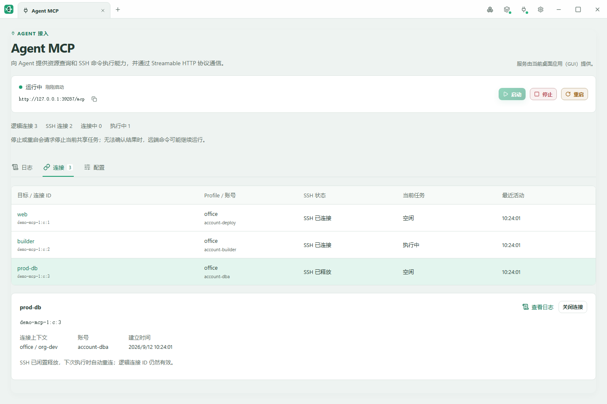

# 在 GUI 中使用 MCP Server

点击窗口顶部的 **MCP 插头图标**，打开独立 Agent MCP Tab，页面标题为 **MCP Server**。图标右下角的绿灯表示服务运行中，红灯表示未运行；悬停可查看状态。重复点击会回到同一 Tab；关闭 Tab 不停止服务。GUI 默认不自动启动 MCP，可在配置页开启自动启动；退出应用会停止服务。页头右侧说明哪个进程提供服务，区分当前桌面应用、其他桌面应用或命令行进程。

模块内按“日志、连接、配置”排列，已配置时默认进入日志页。启动、停止、重启分别用绿色、红色、琥珀色区分，不可用的按钮会淡化显示。

下方三张截图使用演示数据，Profile、目标与 Token 均为样例。

## 配置与启动

配置页上方是“启动行为”，下方是“连接与访问配置”。两张卡片左右对齐，沿用设置模块的宽度与留白方式：宽窗口下达到最大宽度后不再拉伸，较窄窗口下随可用空间缩放。

1. 先在 Profile 中完成 JumpServer 登录。
2. 首次使用、尚未保存 Bearer Token 时，MCP 自动进入“配置”页并显示引导。检查监听地址和端口，输入或生成 Bearer Token，然后保存；仅生成而未保存时仍不能启动。默认只允许本机访问；TLS 证书与私钥同时留空时使用 HTTP。
3. 点击公共区域的“启动”，把显示的实际服务地址和配置中的 Token 提供给 Agent。
4. “重置”和“保存”位于配置表单右上角；有修改时，“重置”左侧会出现琥珀色“未保存”标签，保存或重置后隐藏。修改配置后需要保存并重启服务才生效。“重置”只恢复上次保存值，运行中的地址不会随草稿变化。

图中已保存连接配置，因此没有“未保存”标签，表单的“重置”和“保存”按钮呈禁用状态。“随应用启动 MCP”是演示中手动开启的，默认仍为关闭；它只影响下次应用启动，所以当前服务仍显示“已停止”。本次要使用服务，点击上方“启动”。实际使用时请在自己的应用中生成 Token，图中的 `DEMO_ONLY` 值不能用于真实服务。

存在活动任务时，停止或重启前会显示确认。无法确认远端命令结束时，服务会提示结果未知；应先核对服务器状态，不能直接重跑。若服务由其他进程拥有，请在那个宿主中管理连接和日志。

## 随应用自动启动

“配置”页顶部的“启动行为”提供 **随应用启动 MCP** 开关，默认关闭。先完成并保存下方的连接与访问配置，才能开启。开关更改后立即自动保存到 GUI 专用的 `gui.toml`，不需要点击表单的“保存”；表单的“重置”也不会改变开关。

更改从下次启动桌面应用起生效，不会立即启动或停止当前 MCP 服务。自动启动在后台进行，不依赖 MCP Tab 是否打开，也不阻塞资产查询、终端等功能。失败时会显示非阻塞提示，并在 MCP 日志中保留记录；本次应用运行期间不会自动重试，可检查配置或端口占用后手动启动。

## 查看运行日志

“日志”页顶部的“输出级别”提供精简、标准和详细三个选项，右侧同一行显示“仅影响后续日志，已显示的内容保持不变”，工具栏右端是“暂停显示”和“清空显示”。提示不再单独占行，为下方日志保留更多空间。

日志采用只读文本流。精简显示服务、连接和异常；标准增加命令受理、结束与取消，以及 MCP 工具调用摘要，资源查询包含返回数量、分页状态和耗时；详细增加命令输入和查询条件。切换级别只影响后续日志，已有行保持原样，不补显示此前过滤的查询条件。命令的非零退出码仍是正常返回；日志不显示 stdout/stderr 或查询结果正文，Agent 通过任务接口读取仍保留的输出。

服务信息查询、连接／任务查询、重复请求返回原结果、重复关闭和取消已结束任务也会留下调用记录。SDK 在进入业务处理前拒绝的工具调用记录为 `MCP_REJECTED`，具体错误由 MCP 响应提供。这里记录的是工具调用与业务事件，不是每个 HTTP 请求或协议初始化消息的访问日志。

图中先切换为“详细”，再启动服务接收样例日志。`test -f` 返回 `exit=1`，执行状态仍是 `completed`；这表示命令已正常返回，条件未成立，不属于 SSH 发送或结果接收失败。

点击“终端样式”可调整共用的字体、字号、行高与配色，同时影响 SSH 终端和 MCP 日志。应用明暗主题不覆盖终端配色。

向上滚动时停止跟随，点击“回到最新”恢复。暂停显示期间继续采集，恢复后追加；缓存有上限，较早内容可能回收。“清空显示”不会删除任务结果或去重记录。日志仅在当前宿主内存中保留，同一进程重启服务后仍可查看部分历史，退出应用后丢失。

## 管理连接

“连接”页显示逻辑连接、实际 SSH 状态、目标、账号及活动任务。**SSH 已释放**时逻辑 ID 仍然有效，下次执行可自动重连。空闲连接可直接关闭；有任务的连接确认后等待任务结束，再使 ID 失效。

图中 `web` 空闲，`builder` 正在执行任务，`prod-db` 的 SSH 已释放。选择连接可查看下方详情，点击“查看日志”只显示该连接已接收的日志；筛选条右侧的 × 按钮可取消连接筛选。

当前尚无 CLI MCP 启动入口。完整行为及容量限制见 [MCP 设计](../specs/agent-mcp.md)。

## 让 Agent 下载文件

可以直接说：“把 work 环境 prod-db 上最新的应用日志下载到这台电脑，完成后告诉我保存位置。”支持单个文件、多个文件和目录，也可以指定本地保存位置。文件保存到运行 JumpAccess 的电脑上。

软件自动选择 SFTP 或 `sz`，在服务器上压缩、下载后自动解压；已有的压缩文件保持原样，不修改源文件。正在写入的日志也可以下载，但本次读取开始后追加的内容不包含在内。下载不会占用正在使用的终端。

下载期间，服务器的用户 home 或其他可用暂存位置会出现 `.jumpaccess-download-<时间>-<UUID>.gz`、`.tar.gz` 等临时文件，生成过程中可能带有 `.part` 后缀；也可能短暂出现 `.jumpaccess-probe-` 开头的目录探测文件。这些文件由 JumpAccess 创建，正常结束后自动清理。应用意外退出或网络中断时可能残留；确认相关任务已结束后可删除，重启应用不会自动清扫旧文件。

完成后，Agent 会告知本地保存位置；每次下载存放在独立目录，不覆盖已有文件。可在 MCP“日志”页查看进度和异常；关闭 MCP 页签不影响下载，退出应用会停止任务。

当前版本的服务器环境要求及限制见 [MCP 设计：文件传输](../specs/agent-mcp.md#文件传输)。
