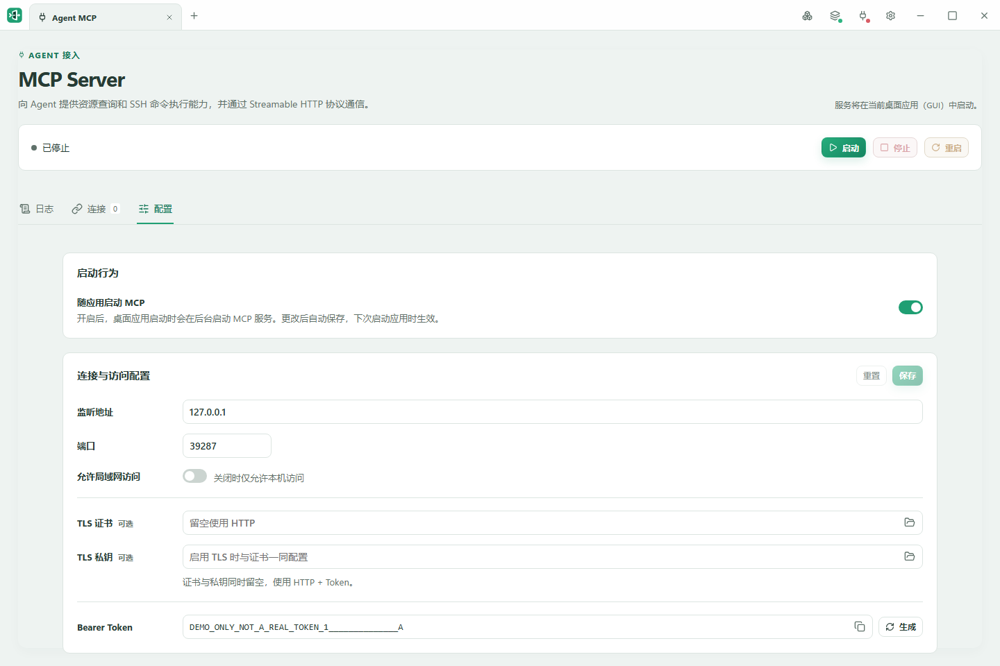
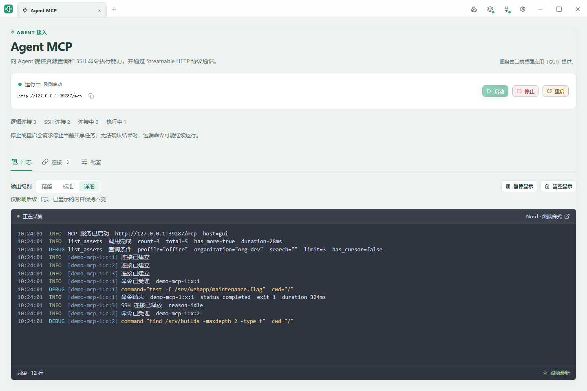
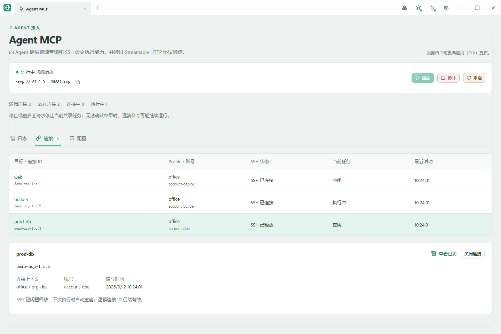

# 使用 MCP Server

GUI 和 CLI 都可以启动同一套 Streamable HTTP MCP 服务，让 Agent 查询资源、复用 SSH 连接、执行命令、下载文件、上传本机文件及使用 HTTP 中转。默认服务地址为 `http://127.0.0.1:39287/mcp`，配置与访问 Token 共用 `config.toml`，同一应用数据目录只运行一个实例。先通过任一入口完成所需 Profile 的 JumpServer 登录，再选择 GUI 或 CLI 承载服务。

升级后先用新版本重新启动 MCP，再让 Agent 客户端重新连接并刷新工具定义。若连接或文件任务的目标参数仍要求必填 `profile`、不接受 `target.name`，或缺少 HTTP 上传工具，应核对是否缓存了旧定义；资源列表工具仍需显式查询范围。仅更新程序文件不会刷新已连接客户端的工具列表。

## 在 GUI 中使用

点击窗口顶部的 **MCP 插头图标**，打开独立 Agent MCP Tab，页面标题为 **MCP Server**。图标右下角的绿灯表示服务运行中，红灯表示未运行；悬停可查看状态。重复点击会回到同一 Tab；关闭 Tab 不停止服务。GUI 默认不自动启动 MCP，可在配置页开启自动启动；退出应用会停止服务。页头右侧说明哪个进程提供服务，区分当前桌面应用、其他桌面应用或命令行进程。

模块内按“日志、连接、配置”排列，已配置时默认进入日志页。启动、停止、重启分别用绿色、红色、琥珀色区分，不可用的按钮会淡化显示。

下方三张截图使用演示数据，Profile、目标与 Token 均为样例。

### 配置与启动

配置页上方是“启动行为”，下方是“连接与访问配置”。两张卡片左右对齐，沿用设置模块的宽度与留白方式：宽窗口下达到最大宽度后不再拉伸，较窄窗口下随可用空间缩放。

1. 先在 Profile 中完成 JumpServer 登录。
2. 首次使用、尚未保存 Bearer Token 时，MCP 自动进入“配置”页并显示引导。检查监听地址和端口，输入或生成 Bearer Token，然后保存；仅生成而未保存时仍不能启动。默认只允许本机访问；TLS 证书与私钥同时留空时使用 HTTP。
3. 点击公共区域的“启动”，把显示的实际服务地址和配置中的 Token 提供给 Agent。
4. “重置”和“保存”位于配置表单右上角；有修改时，“重置”左侧会出现琥珀色“未保存”标签，保存或重置后隐藏。修改配置后需要保存并重启服务才生效。“重置”只恢复上次保存值，运行中的地址不会随草稿变化。



图中已保存连接配置，因此没有“未保存”标签，表单的“重置”和“保存”按钮呈禁用状态。“随应用启动 MCP”是演示中手动开启的，默认仍为关闭；它只影响下次应用启动，所以当前服务仍显示“已停止”。本次要使用服务，点击上方“启动”。实际使用时请在自己的应用中生成 Token，图中的 `DEMO_ONLY` 值不能用于真实服务。

存在活动任务时，停止或重启前会显示确认。无法确认远端命令结束时，服务会提示结果未知；应先核对服务器状态，不能直接重跑。若服务由其他进程拥有，请在那个宿主中管理连接和日志。

### 随应用自动启动

“配置”页顶部的“启动行为”提供 **随应用启动 MCP** 开关，默认关闭。先完成并保存下方的连接与访问配置，才能开启。开关更改后立即自动保存到 GUI 专用的 `gui.toml`，不需要点击表单的“保存”；表单的“重置”也不会改变开关。

更改从下次启动桌面应用起生效，不会立即启动或停止当前 MCP 服务。自动启动在后台进行，不依赖 MCP Tab 是否打开，也不阻塞资产查询、终端等功能。失败时会显示非阻塞提示，并在 MCP 日志中保留记录；本次应用运行期间不会自动重试，可检查配置或端口占用后手动启动。

### 查看运行日志

“日志”页顶部的“输出级别”提供精简、标准和详细三个选项，右侧同一行显示“仅影响后续日志，已显示的内容保持不变”，工具栏右端是“暂停显示”和“清空显示”。提示不再单独占行，为下方日志保留更多空间。

日志采用只读文本流。精简显示服务、连接和异常；标准增加命令受理、结束与取消，以及 MCP 工具调用摘要，资源查询包含返回数量、分页状态和耗时；详细增加命令输入和查询条件。切换级别只影响后续日志，已有行保持原样，不补显示此前过滤的查询条件。命令的非零退出码仍是正常返回；日志不显示 stdout/stderr 或查询结果正文，Agent 通过任务接口读取仍保留的输出。

服务信息查询、连接／任务查询、重复请求返回原结果、重复关闭和取消已结束任务也会留下调用记录。SDK 在进入业务处理前拒绝的工具调用记录为 `MCP_REJECTED`，具体错误由 MCP 响应提供。这里记录的是工具调用与业务事件，不是每个 HTTP 请求或协议初始化消息的访问日志。



图中先切换为“详细”，再启动服务接收样例日志。`test -f` 返回 `exit=1`，执行状态仍是 `completed`；这表示命令已正常返回，条件未成立，不属于 SSH 发送或结果接收失败。

点击“终端样式”可调整共用的字体、字号、行高与配色，同时影响 SSH 终端和 MCP 日志。应用明暗主题不覆盖终端配色。

向上滚动时停止跟随，点击“回到最新”恢复。暂停显示期间继续采集，恢复后追加；缓存有上限，较早内容可能回收。“清空显示”不会删除任务结果或去重记录。日志仅在当前宿主内存中保留，同一进程重启服务后仍可查看部分历史，退出应用后丢失。

### 管理连接

“连接”页显示逻辑连接、实际 SSH 状态、目标、账号及活动任务。**SSH 已释放**时逻辑 ID 仍然有效，下次执行可自动重连。空闲连接可直接关闭；有任务的连接确认后等待任务结束，再使 ID 失效。



图中 `web` 空闲，`builder` 正在执行任务，`prod-db` 的 SSH 已释放。选择连接可查看下方详情，点击“查看日志”只显示该连接已接收的日志；筛选条右侧的 × 按钮可取消连接筛选。

完整行为及容量限制见 [MCP 设计](../specs/agent-mcp.md)。

## 在 CLI 中使用

### 首次配置与启动

已有 Profile 时，可以直接执行：

```text
jumpctl mcp config --rotate-token
jumpctl mcp serve
```

尚未配置 Profile 时，先按 [CLI 入门](cli-quick-start.md) 添加站点。`--rotate-token` 在首次使用时生成 Token，已经配置时替换旧值；命令保存成功后自动列出全部配置，包括明文 Token。把输出中的服务 URL 和 Token 配置到 Agent。`serve` 使用已经保存的配置前台运行，并持续显示 MCP 调用日志。

MCP 调用不会打开登录或主机密钥确认窗口。如果连接提示 JumpServer SSH gateway 尚未受信任，先通过普通 CLI 或 GUI SSH 连接核对并确认指纹，再重试 Agent 请求。

当前终端在服务停止前不会返回命令提示符。按 Ctrl+C 停止服务并释放后台资源，已输出的日志和终端滚动历史原样保留，不清屏；重新运行 `jumpctl mcp serve` 即可再次启动。

### 修改配置

查看配置和单项修改：

```text
jumpctl mcp config
jumpctl mcp config --port 39288
```

一次修改多项、设置已有 Token，以及配置或关闭 TLS：

```text
jumpctl mcp config --listen-host 0.0.0.0 --allow-lan=true --rotate-token
jumpctl mcp config --token <value>
jumpctl mcp config --tls-cert <cert-path> --tls-key <key-path>
jumpctl mcp config --no-tls
```

`config` 无修改选项时只查看配置；带修改选项时，一条命令就是一次保存：仅修改指定字段，全部校验成功后才写入，再完整显示已保存配置。显式 `--allow-lan=false` 可以关闭局域网访问，也属于修改；`--help` 等展示选项不会保存配置。`config` 不设 `set`、`get` 子命令或兼容别名。`--token` 和 `--rotate-token` 互斥；`--no-tls` 与两个 TLS 路径选项互斥。配置 Token 必填，首次保存时可以把网络设置和 `--rotate-token` 放在同一条命令中。所有配置修改均在服务下次启动或重启时生效，运行中的服务继续使用原地址和 Token。

### 查看状态与日志

在另一个终端查看运行中的服务：

```text
jumpctl mcp status
```

状态显示服务宿主、实际地址、启动时间及是否需要重启；不会接管另一个 CLI 或 GUI 进程。已有服务时重复执行 `serve` 会报告现有实例，不会换端口启动第二个服务。更换宿主须先停止原服务，原来的连接和任务 ID 随之失效。

前台日志默认使用“标准”详细程度。可以选择详细日志，或将日志保存为纯文本：

```text
jumpctl mcp serve --log-level detailed
jumpctl mcp serve --color never > mcp.log 2>&1
```

`--log-level` 的 `minimal`、`standard`、`detailed` 分别对应 GUI 的精简、标准、详细。`INFO`／`DEBUG` 写 stdout，`WARN`／`ERROR` 和宿主诊断写 stderr；`2>&1` 将两个流一起收集。非零远端退出码仍是正常命令结果，日志保留真实退出码，不把远端 stdout/stderr 正文直接输出到本地终端。

颜色默认 `--color auto`，终端支持 ANSI 时保留 GUI 对应的颜色，重定向到文件或管道时使用纯文本；`always` 强制保留，`never` 关闭。具体颜色由终端主题决定。完整选项见 [CLI 命令参考](../cli.md#mcp-server)。

## 按名称直接连接

已知别名或资产名称时，可以直接说“连接 test207 并执行……”。Agent 首次调用 `get_server_info` 获取实例和请求代号后，即可调用：

```json
{
  "target": {"name": "test207"},
  "request_key": "实例:代号:新生成的UUID"
}
```

以上是 `open_connection` 参数示意，实际请求键须使用查询所得值。省略 `profile` 时读取当前 Profile；也可显式指定。名称优先匹配别名，否则查找唯一的资产名称、地址或 UUID。组织默认沿用别名或当前组织，没有账号绑定时只自动选择唯一托管账号；有歧义时返回查询范围和候选，明确选择后再发起新请求。不会修改当前配置或自动跨 Profile 搜索。

正常流程不必先调用 `list_profiles`、`list_aliases` 或 `list_assets`。已有 `connection_id` 时可直接执行命令，不必固定增加 `get_connection`；若打开请求还没有返回连接 ID，保留原键和参数继续等待。网络或登录失败按错误原因处理，不通过枚举资源代替排障。上传、下载及 HTTP 上传准备也接受相同的 `target.name`，已知远端路径时无需先打开命令连接。

## 让 Agent 下载文件

可以直接说：“把 work 环境 prod-db 上最新的应用日志下载到我的下载目录，完成后告诉我保存位置。”支持单个文件、多个文件、目录和正在写入的日志，也可以指定保存位置。

仅供本机访问时，文件直接保存到运行 JumpAccess 的电脑；开启局域网共享监听，或服务没有目标目录的写入权限时，提供下载链接供调用方保存。链接就绪不代表已经保存到你的电脑。直接保存的结果可直接使用，无需再解压或校验；单个文件或目录保留原名和层级，多个独立对象放在一个结果目录，重名另存。

软件自动选择 SFTP 或 `sz`，在服务器上准备压缩文件，不修改源文件，也不占用正在使用的终端。单文件链接通常为 `.gz`，目录或多文件为 `.tar.gz`；正常下载、按说明解压即可，无需额外计算哈希或回服务器核验。自动添加的压缩包在成功解压后清理；原本就是压缩文件的目标保持原样。日志读取开始后的新增内容留给下次下载。

下载期间，服务器的 home 或其他可用暂存位置可能出现 `.jumpaccess-download-<时间>-<UUID>.gz`、`.tar.gz`、`.part` 或 `.jumpaccess-probe-` 开头的临时文件，正常结束后自动清理。异常退出可能遗留远端文件，重启应用不会自动清扫它们。

下载链接就绪后有效 30 分钟；停止或重启 MCP 会使旧链接失效。领取文件暂存在 JumpAccess 自管缓存目录，到期后自动清理，不影响已经保存的最终文件。GUI 可在 MCP“日志”页查看进度和异常，CLI 通过 `serve` 的持续日志查看；关闭 GUI 的 MCP 页签不停止下载，退出宿主或停止服务会停止任务。

每项任务传输的压缩包或原样文件最多 1 GiB；完整环境要求和边界见 [MCP 文件传输设计](../specs/agent-mcp-file-transfer.md)。

## 让 Agent 上传本机文件

可以说：“把运行 JumpAccess 的电脑上的 `D:\work\config` 上传到 work 环境 test207 的 `/opt/app`，完成后告诉我最终路径。”服务读取本机绝对路径，最终得到 `/opt/app/config`。目录、多文件和空文件均可上传；多个独立来源直接放入目标目录，不添加额外结果目录。

调用方须先确认源文件属于运行 MCP 的电脑，并以 `source=local` 调用 `upload_files`，提供 `local_paths`、`remote_directory`、明确目标或已有连接 ID，以及当前实例的请求键。返回任务 ID 后通过 `get_upload` 持续等待；`list_uploads` 可找回任务，`cancel_upload` 请求取消。CLI 和 GUI 宿主的工具和结果相同。

服务自动压缩普通文件，目录与多文件打包为 `.tar.gz`，已有压缩文件保持原样。优先使用 SFTP，必要时回退 `rz`；先写入已验证的远端暂存目录，再在目标目录内的隔离位置还原，完整后发布。目标目录须已存在且可写，远端需提供 POSIX、Python 3.7+ 及排他重命名能力；缺少相应支持会明确失败。

已有同名文件或目录不会被覆盖或合并，源文件也不会被删除。还原保留名称、内容和目录结构，不迁移权限或时间戳；远端文件为 `0600`、目录为 `0700`，需要执行权限或其他访问权限时另行设置。每项实际传输包最多 1 GiB，最多 100 个源路径、展开最多 1000 项；同一实例最多同时执行 4 项上传。

只有 `files_ready=true` 表示全部最终文件已发布。部分失败时按 `files` 查看各项状态，已成功发布的文件保留；`unknown` 时先核对最终路径，不能直接换请求键重传。临时内容正常结束后清理，清理告警单独报告；异常退出可能留下本机准备包或远端 `.jumpaccess-upload-` 目录，重启不会按名称前缀批量清扫。源文件和已发布文件不受清理影响。

调用方与服务不共享文件系统，或服务无读取权限时，按下节使用 HTTP 中转。源文件不存在或准备失败仍明确报错，不自动换读其他路径。

## 通过 HTTP 中转上传

源文件在另一台电脑上，或 JumpAccess 没有读取权限时，由能读取文件的调用方发送内容。Agent 须能在源文件所在环境打包并发送 HTTP 请求；只能调用 MCP 工具、不能发送文件正文的客户端无法完成此流程。CLI 和 GUI 宿主使用相同接口，服务监听地址、局域网开关、Host／Origin 和 TLS 限制仍然适用。

“允许局域网访问”只改变服务的网络访问范围，不会自动把本机上传切换成 HTTP 中转。调用方与服务共享文件系统且服务有读取权限时，优先使用 `source=local`；需要验证 HTTP 流程时，同一台电脑也可通过下面的准备、PUT、提交步骤上传，保持 `127.0.0.1` 监听即可。跨设备使用时，再配置其他设备可达的监听地址并开启局域网访问。

1. 在源文件所在环境准备传输包：单个普通文件使用 gzip，目录或多个来源使用 tar.gz；已经是压缩文件的单个来源使用 raw，保留原内容。格式声明只代表本次新增的外层，服务不会按扩展名继续解压内部文件。
2. 调用 `prepare_upload`，提供明确的 `target` 或 `connection_id`、远端绝对目录 `remote_directory`、准备包实际字节数 `size`、`format` 和 `entries`，以及新的 `request_key`。清单按归档顺序列出每项相对名称 `name`、原始字节数 `size` 和布尔值 `directory`；父目录先于子项，目录大小为零，不包含链接、绝对路径、越界或重复名称。raw 和 gzip 只能声明一个普通文件，tar.gz 包含全部目录与文件。
3. 取得 `source_id` 后，若状态为 `preparing`，使用 `get_upload_source` 等待目标解析完成；`waiting` 时按返回的 `url` 和 `method=PUT` 发送准备包的原始字节。不能使用 multipart、HTTP 内容编码转换或分段续传，也不要把正文填入 MCP 参数。接收地址携带限时凭据，应按敏感信息保管。
4. `get_upload_source` 返回 `ready` 后，以 `source_id` 和另一枚新的 `request_key` 调用 `commit_upload`。服务重新检查目标身份和授权，然后创建远端上传任务；可通过 `wait_ms` 短等结果，或使用返回的 `upload_id` 调用 `get_upload` 持续等待。

例如在 PowerShell 中，将已准备好的包发送到工具返回的完整地址：

```powershell
curl.exe --fail-with-body --request PUT --upload-file 'D:\work\bundle.tar.gz' '<prepare_upload 返回的 url>'
```

HTTP 成功只表示准备包已到达 JumpAccess。只有上传任务的 `files_ready=true` 才表示全部内容已在目标服务器还原并发布；冲突、部分发布、取消和未知结果的处理与本机上传相同。准备和提交分别去重，同一步重试保留原请求键。HTTP 响应丢失时先查 `get_upload_source`：`receiving` 等待接收结束，`waiting` 才可在原接收有效期内整包重试，`ready` 直接提交，`submitted` 查询其 `upload_id`；同一对象不能创建第二项上传。提交结果不明时用原提交请求键核对，不能重新准备内容后换键重传。

每个准备包最多 1 GiB，清单最多 1000 项、100 个顶层对象。接收资格自申请起有效 30 分钟，收齐后另有 30 分钟的待提交时间；查询和重复请求不续期。上传缓存独立限制为 8 GiB、50 个对象，包含预留、任务持有和未删除残留。HTTP 同时最多接收 4 路，每个对象只允许一路写入；60 秒无进展或单次达到 15 分钟时停止接收。

不再需要的未提交内容可通过 `cancel_upload_source` 取消；已经提交的任务使用 `cancel_upload`。到期未提交的内容自动清理，任务接管后保护至任务结束。停止或重启 MCP 会使旧接收地址和未提交内容失效；GUI 有待提交对象时会提示，CLI 停止服务遵循相同规则。清理不会删除源文件或远端已发布文件。
