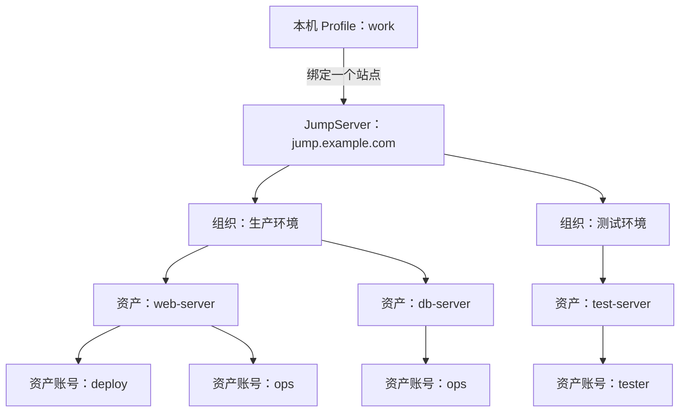

# 理解数据层级结构

连接一台主机时，按这个顺序选择：**Profile → JumpServer 站点 → 组织 → 资产 → 资产账号**。以下为虚构示例，适用于 CLI 和桌面客户端。

## 先看整体关系

Profile 保存在本机；组织、资产和账号由 JumpServer 管理，你能看到和使用哪些资源取决于授权。

## Profile

Profile 是一份本地连接配置，例如 `work`。每个 Profile 绑定一个 JumpServer 站点，并关联自己的登录凭据、默认组织和别名。多个 Profile 可以指向同一站点。

## 组织（Organization）

组织（Organization）是 JumpServer 划分资源和权限的范围，例如“生产环境”“测试环境”。一个站点可以有多个组织，每个组织可以有多个资产。同一个 Profile 可以访问该站点中你有权使用的不同组织。

## 资产（Asset）

资产（Asset）是要访问的目标资源，例如一台服务器、数据库或网络设备。对本手册的 SSH 场景而言，就是你准备连接的主机。名称和地址帮助你识别它，ID 用于明确定位。

## 资产账号（Account）

资产账号（Account）是登录某个资产时使用的身份，例如 `deploy` 或 `ops`。一台资产可以有多个可用账号，连接时需要从这台资产获准使用的账号中选择；同一组织里的账号不能默认用于所有资产。

### 两种账号有什么区别

| 类型 | 用途 |
| --- | --- |
| JumpServer 用户账号 | 在浏览器中登录 JumpServer，决定你有哪些资源访问权限 |
| 资产账号 | 登录具体资产，决定你在远程主机上使用哪个身份 |

例如，你用自己的 JumpServer 用户账号完成认证，再以 `deploy` 身份连接 `web-server`。

## 资产别名（Alias）

别名（Alias）是在某个 Profile 中保存的连接快捷名称。它必须指定资产，也可以绑定组织和账号。例如，`work` 中的 `web` 可以指向“生产环境 → web-server → deploy”，以后就能用 `web` 连接。

一个 Profile 可以有多个别名，不同 Profile 也可以使用相同的别名名称。别名只保存连接选择，不会增加远程访问权限。

---

接下来，可以查看具体的操作手册

- [jumpctl CLI 快速入门](cli-quick-start.md)

[返回用户手册](README.md)
