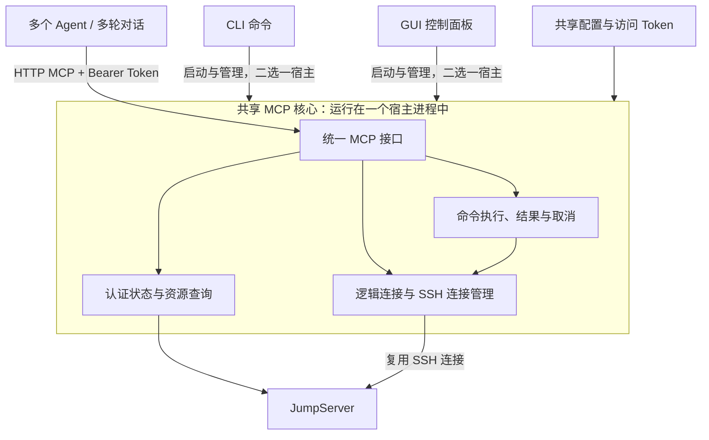

# Agent MCP 接入设计

状态：需求已确认，开发中。GUI 已提供独立 MCP 工作区、连接管理、文本日志、配置、Token、启停、GUI 后台自动启动、资源查询、SSH 连接复用、命令任务、输出、超时与取消。连接与日志数据由共享 Go 核心提供；CLI MCP 入口尚未实现，本轮明确不增加。下文涉及 CLI 命令的部分仍为目标能力。

更新日期：2026-10-19。

## 目标与范围

让 AI Agent 独立通过 JumpAccess 查询 JumpServer 资源、选择服务器与账号，并复用 SSH 连接执行已授权命令。多个 Agent、多轮对话可以共用同一个 MCP 服务，减少重复连接和认证的等待。

CLI 与 GUI 均提供相同的 **Streamable HTTP MCP** 服务，使用同一套配置、工具和结果语义。目标客户端包括支持该接入方式的 Codex、Claude Code 等 Agent；Windows 与 macOS 上的产品行为保持一致。

首期提供资源查询、连接管理、非交互命令执行、长任务查询、超时与取消，以及单 Token 鉴权。实际访问仍受 JumpServer 账号权限和策略约束，命令审批流程不在本次范围内。

首期不提供持久交互 Shell、交互输入、接管人类 SSH 会话、文件传输、端口转发、远程公网部署、多用户权限划分或服务重启后的任务恢复。

## 基本架构与状态归属

同一应用数据目录只运行一个 MCP 实例，由 CLI 或 GUI 进程承载，不为每个 Agent 启动独立服务。另一入口可查看运行状态；重复启动应说明现有实例的地址和宿主，不能自动换端口再开一个实例。

配置与访问 Token 持久保存；逻辑连接、SSH 连接和执行记录由运行中的 MCP 实例共享，不归属于某个 Agent 对话或 HTTP 会话。Agent 断开、工具请求结束或切换对话，不自动关闭连接或取消已受理命令。人类在 GUI／CLI 中打开的 SSH 会话独立管理。

CLI 与 GUI 更换宿主后，Agent 可以继续使用相同的地址、Token 和工具接口；更换宿主需要停止原实例，因此原有连接与执行 ID 失效，不承诺任务无缝迁移。

## 用户如何配置和使用

用户先通过现有入口完成 JumpServer 登录，再配置 MCP 的访问 Token 和监听地址，选择 CLI 或 GUI 启动服务，最后把服务 URL 与 Token 配置到 Agent。

| 用户操作 | CLI 入口 | GUI 入口 |
| --- | --- | --- |
| 启动服务 | `jumpctl mcp serve`，前台运行 | 点击“启动” |
| 查看运行情况 | `jumpctl mcp status` | 状态面板显示宿主、实际地址、连接数、执行数和错误 |
| 查看或修改配置 | `jumpctl mcp config`、`jumpctl mcp config set` | 在配置框内编辑，统一保存或重置 |
| 管理 Token | `jumpctl mcp token generate/set/show/rotate` | 单个明文输入框，支持输入、复制和生成；与其他配置一起保存 |
| 停止或重启服务 | 结束服务命令，按需重新启动 | 配置框外的“停止”“重启”；有任务时显示影响和停止进度 |

默认地址为 `http://127.0.0.1:39287/mcp`，GUI 默认不自动启动 MCP。局域网访问默认关闭，启用时必须显式选择监听范围。当前采用预共享 Token，不提供 OAuth 授权服务器；本机和局域网均允许使用 HTTP + Token，TLS 为可选配置：证书、私钥同时留空使用 HTTP，同时填写使用 HTTPS，只填写其中一项应报错。HTTP 不加密 Token 和传输内容；服务不自动开放防火墙。

访问 Token 必填，不提供无 Token 启动或匿名访问模式。单一 Bearer Token 的持有者拥有相同 MCP 权限，共享连接、执行及结果，也能关闭或取消其他调用方的任务；首期不提供 Agent 之间的权限隔离。MCP Token 与网络设置统一保存在 `config.toml`，独立于 JumpServer 登录凭据。GUI 配置页使用一个始终明文显示的 Token 输入框，不提供显示／隐藏开关或单独保存按钮；“生成”只替换草稿。除用户显式查看或编辑外，Token 不进入状态输出、实例描述或日志；CLI 不通过明文命令行参数接收 Token。

GUI 顶部 MCP 快捷入口采用与 Profile 相同尺寸的单图标与红绿状态灯，打开独立单例 Tab，页面按“日志”“连接”“配置”排列，已配置时默认显示日志；设置页不再承载 MCP。页头复用资产、Profile、设置的标题组件，包含绿色引导文字、主标题和完整功能说明；MCP 使用与 Tab 相同的插头图标，右侧以完整文字说明提供服务的进程。关闭或切换 Tab 不停止服务，重新打开保留本宿主的日志显示状态。首次读取到未配置 Token 且未运行的状态时，默认进入配置页并提示先保存必要设置；后续轮询不覆盖用户选择的页面。服务控制、实际地址和统计位于公共区域，启动、停止、重启按钮分别采用绿色、红色、琥珀色，禁用时淡化显示。需要保存的监听地址、端口、局域网开关、TLS 与 Token 放在配置页的同一框中，使用左侧标签、右侧输入控件；TLS 路径支持手写与系统文件选择，按钮位于输入框内。Token 标题为“Bearer Token”，复制按钮位于输入框内，“生成”位于框旁。端口必须为 1–65535 的整数，监听地址和访问范围、Token 格式、TLS 配对及证书可用性均须校验，无效配置不得保存。配置表单右上角依次显示未保存提示、重置和保存；仅有修改时显示琥珀色“未保存”标签，保存或重置后隐藏，不显示“已保存”标签。配置校验与保存错误显示在框内标题旁，服务操作错误显示在公共控制区域。

连接页区分逻辑连接和实际 SSH 状态，展示固定目标、Profile、组织、账号、活动执行 ID 与最近活动时间。SSH 释放不意味着逻辑 ID 失效。空闲连接直接关闭，忙碌连接经确认后等待当前任务结束并关闭；等待期间阻止新命令。存在活动任务时，停止或重启服务先确认影响。其他进程拥有服务时，当前 GUI 只显示已有实例状态，不读取另一个宿主的内存日志、控制其连接或停止服务。

日志页采用只读连续文本流，复用“终端样式”的字体、字号、行高、背景和 ANSI 色板，与应用明暗主题独立。精简显示服务与连接事件、错误和未知结果；标准增加命令受理、结束、取消请求与 MCP 工具调用摘要，资源查询摘要包含本页数量、总量、是否还有下一页及耗时；详细增加命令输入、工作目录和查询条件。查询条件通过类型白名单提取 Profile、Organization、资产 ID、搜索条件、分页限制或任务 ID 等；分页游标仅记录是否存在，不保留原文。单个条件字符串字段最多保留 512 字节，条件文本最多 4 KiB，超出截断并标记。退出码非零仍按正常完成记录，stderr 不构成传输错误；stdout/stderr、环境变量与查询结果正文不进入日志文本。底层记录不受显示级别影响，切换级别仅影响之后接收到的日志，不改写已经显示的行。对应提示位于级别按钮右侧，与工具栏同排，减少日志区上方占用；较窄窗口允许自然换行。

全部 15 个 MCP 工具均有日志路径，包括 `get_server_info`、重复请求返回原结果、关闭已关闭连接、取消已结束任务；SDK 在类型化业务处理前拒绝的工具调用记录安全摘要 `MCP_REJECTED`，不记录原始参数或错误正文。这是工具调用与业务事件日志，不包含 HTTP 访问、鉴权拒绝或协议初始化／发现的逐请求日志。普通查询的摘要与条件是同一条操作记录的两个事件；首次执行仍由唯一任务记录承载受理、输入与结束事件。重试、关闭和取消调用可使用单独的有界轻量摘要记录，只保存标识与状态，不复制原始输入或输出，也不向原任务无限追加重试事件。

暂停只暂停显示，继续读取并保留有界待显示数据；恢复后追加。向上滚动停止跟随，点击“回到最新”恢复；清空只清理当前显示和待显示缓存，不删除底层操作、输出或去重索引。每个显示／暂停缓存最多 3000 行、2 Mi 字符，达到任一上限回收最早内容；后端游标发生缺口时提示历史已回收。显示缓存是用于阅读的文本投影，不是另一份任务结果库。

所有配置包括 Token 均可在运行中编辑和保存，保存不会改变运行中的服务；启动或重启后才使用已保存值。服务控制位于配置框外，独立于保存操作。“配置”页顶部另设“启动行为”卡片，提供默认关闭的“随应用启动 MCP”开关，即时保存到 GUI 专用的 `gui.toml` 的 `[mcp].auto_start`，不参与连接配置的保存、重置或未保存状态。两张配置卡片共用设置模块的内容宽度和留白规则，最大宽度为 1260px，较窄窗口下随可用宽度缩放；公共页头、服务控制栏、Tab 栏及日志和连接内容保持使用可用宽度。未保存有效连接配置时不能开启；配置丢失后仍可关闭已有开关。更改只影响下次应用启动，不立即启停服务。桌面启动回调在后台尝试一次启动共享 MCP 核心，不依赖 Tab，不阻塞其他功能；失败进入共享日志并显示非阻塞提示，不自动重试，不接管其他宿主。手动启停、重启或退出会取消待完成的自动启动，退出后不得重新出现监听。

“重置”恢复上次保存的配置，不恢复默认值、不保存、不重启。界面根据已保存值与运行快照判断是否仍需重启：若两者原本相同，撤销未保存修改后提示消失；若此前已保存过不同配置，重置后仍提示重启。只有运行中的服务有待生效修改时显示重启提示栏，其余情况不显示、不留占位；未保存状态仅在配置框右上角标识。服务实际地址在重启前保持不变。Token 切换生效后，Agent 需要更新凭据。登录失效或需要人工认证时返回明确错误，不在 Agent 调用中弹出交互登录流程。

## Agent 可用能力

以下为对外工具的能力划分；两种宿主提供相同工具及返回含义。

| 能力 | 工具 | 用户可观察的结果 |
| --- | --- | --- |
| 服务与资源发现 | 服务状态查询、`list_profiles`、`list_organizations`、`list_assets`、`get_asset`、`list_accounts`、`list_aliases` | 可用配置、认证状态、资源、账号及能力，不返回账号秘密 |
| 打开与查看连接 | `open_connection`、`list_connections`、`get_connection` | 获取或复用逻辑连接 ID，查看目标、状态与闲置情况 |
| 关闭连接 | `close_connection` | 关闭指定连接，说明受影响任务；支持仅空闲时关闭、等待任务结束和强制关闭 |
| 执行命令 | `execute_command` | 返回执行 ID、当前状态、输出和可获得的退出结果 |
| 跟踪与停止任务 | `get_execution`、`list_executions`、`cancel_execution` | 增量读取输出、找回任务、请求停止或放弃跟踪 |

Agent 必须明确选择 Profile、组织、资产和账号，也可以使用能够唯一解析的 Alias。目标存在歧义时返回错误，不能自行选择第一项，也不能改变人类当前选择的 Profile。

典型流程是查询资源、打开连接、保存连接 ID，再多次执行命令；长任务用执行 ID 继续查询。不再使用时可以主动关闭连接，服务同时提供自动回收作为兜底。

## 连接复用与并发

逻辑连接表示固定的目标与登录身份，连接 ID 是 Agent 使用的句柄；底层 SSH 连接是实际网络资源。多次打开同一目标默认允许复用逻辑连接，也可以明确申请独立连接。已建立连接不会随 Alias 或当前登录身份变化而悄悄切换目标或账号。

同一逻辑连接一次只接受一条活动命令，其他不同命令返回忙碌，不隐式排队。需要并行执行时使用不同逻辑连接，并受总容量限制。多个 Agent 同时需要恢复同一连接时，共用一次重连，不重复连接和认证。

| 情况 | 服务行为 | Agent 后续操作 |
| --- | --- | --- |
| SSH 正常 | 后续命令复用已有连接 | 继续使用原连接 ID |
| SSH 断线或因闲置被释放，逻辑连接仍有效 | 下次使用时自动重连到原目标；重连有时限，失败返回错误 | 仍可使用原 ID 重试连接；命令重试遵守下文规则 |
| Agent 主动关闭或逻辑连接因容量不足被回收 | 原连接 ID 失效，不能重新打开 | 明确目标，重新打开并保存新 ID |
| MCP 服务重启或更换宿主 | 所有旧连接与执行 ID 失效，返回实例已变化的错误 | 重新打开连接；旧任务不会恢复或自动重跑 |

自动重连只恢复连接。命令只在能够确定尚未发送时，才可在恢复后继续发送；只要可能已经发送，就不能自动重放。重连失败必须返回可区分的错误，不能无限等待。

关闭、超时和取消只能影响其指定的连接或执行，不能误伤后来复用该连接的命令。取消一个等待重连的任务，不应取消其他调用方仍在等待的重连；已确认在发送前取消的任务，不能在连接恢复后又开始执行。

## 命令结果、长任务与取消

每条命令独立执行，必须传入绝对工作目录，环境变量按需随命令传入。连接不保留上一次命令的 `cd`、`export` 或其他 Shell 状态，因此重连无需恢复隐含工作目录。首期仅支持无需交互输入的命令。

stdout 与 stderr 分别返回，保留真实退出码，包括非零退出；命令失败不等于连接失效。无法确认命令是否完成时，结果必须明确为“未知”，说明远端可能仍在运行，不能伪装成执行失败、取消成功或超时已终止。

长命令返回执行 ID，Agent 可在后续调用或对话中查询状态与增量输出。单次工具调用的等待时间只决定何时响应，不改变命令执行时限，也不自动取消任务。输出和结果有限保留；截断、未收齐或已过期都必须明确告知。

连接准备和命令运行均有时限。命令默认要求目标支持远端执行时限，无法确认支持时拒绝执行；只有调用方明确接受时，才使用仅限制本地跟踪时间的方式。后者到期不能证明远端命令已停止。主动后台化或脱离当前命令控制的远端任务，不在普通命令超时的终止承诺内。

首期远端时限支持具有 Python 3 的 POSIX 目标，并在每次 SSH 连接建立后验证进程组控制与停止请求的端到端送达能力；不安装远端服务或持久代理。未提供该运行环境或无法通过探测的目标，只能显式使用本地跟踪时限。命令自行返回 124 等非零退出码，不会因此被误报为超时。

取消必须使用执行 ID，区分“请求已发送”“已确认结束”与“停止跟踪但结果未知”。单纯关闭网络连接、取消一次 HTTP 请求或停止读取结果，不等同于远端命令已终止。停止请求发送后仅在有限时间内等待确认；送达失败或确认超时须提供可区分的取消错误，无法确认远端结果时以未知结束跟踪，不能承诺即时取消成功。重复取消共享同一次停止请求和确认期限；原命令自然完成时仍保留真实退出结果。

关闭连接默认要求连接空闲；等待关闭会阻止新命令，待当前任务结束后关闭。强制关闭只能尽力终止，必须报告无法确认的远端任务。服务正常停止时停止接收新任务，并在有限时间内等待与清理；强制退出同样不能保证远端命令已停止。

## 重试与自动清理

打开连接和执行命令使用请求标识防止网络重试重复受理：同一请求标识、相同参数返回同一次操作，不再次执行；同一标识改用不同参数应报错。已过期的旧请求被拒绝，不能因去重记录已清理就当成新命令执行。

结果未知时，Agent 应先查询执行记录或核实远端状态，不能自动更换请求标识重发命令。服务重启或历史过期后查不到记录，也不代表命令从未执行。

错误中的“本次未受理”只描述当前调用。历史过期、请求参数冲突或实例变化时，原执行是否已经发送仍可能未知，不能据此认定原命令未运行。

以下为首期拟定的默认限制，用于明确可观察的回收行为；不依赖 Agent 主动关闭或清理。

| 对象 | 默认限制与回收规则 |
| --- | --- |
| 可用逻辑连接 | 最多 64 个；新建需要名额时回收最久未使用的空闲逻辑连接，原 ID 失效；容量未满时不按闲置时长删除 ID |
| 实际 SSH 连接 | 最多 16 条；满额时优先释放最久未使用的空闲 SSH，保留逻辑 ID |
| SSH 闲置释放 | 无活动操作 10 分钟后释放实际 SSH，原逻辑 ID 下次使用时可自动重连 |
| 已关闭连接历史 | 最多 256 条、最多保留 30 分钟；仅供查询关闭原因，不占可用连接名额，也不能重新打开 |
| 共享操作记录 | 宿主最多 3000 条，包含活动打开／命令操作与服务、连接、查询事件；容量不足按进入顺序回收最早可回收记录，跳过活动操作，没有可回收项时拒绝新受理。执行与打开结果保留原有终结后 30 分钟的兜底过期规则 |
| 命令输入 | 宿主最多 16 MiB 原始命令、目录和环境数据；不足时回收最早的已结束命令记录及其载荷，不能回收正在执行的输入 |
| 输出缓存 | 单次执行最多 8 MiB，同一宿主跨重启累计最多 64 MiB；每块最多 32 KiB，两级链表引用同一个字节块。超限移除最早输出块，保留执行摘要和输出缺口／截断标记 |
| 请求去重索引 | 最多 2500 条，包含活动项，另有 128 条活动请求上限；只保留摘要、结果 ID、失败码及代号，不保留原始命令与输出。满额先移除按终结顺序最早的已结束项；活动项不能移除 |
| 命令执行时限 | 默认 5 分钟，上限 1 小时；查询和重试不延长原时限 |

正在执行、重连或清理的连接不能作为闲置对象回收；没有可回收对象时明确返回容量不足，不能为新请求中止已有任务。状态查询、读取旧结果和保活不延长连接的业务使用时间；查询去重历史也不改变其清理顺序。历史与输出均有界，不永久积累关闭 ID 或请求记录。

3000 与 2500 的差值不构成其他日志的固定保留名额。去重索引与操作记录分别回收：索引仍在而操作已回收时，重复执行返回 `EXECUTION_EXPIRED`（打开操作为 `CONNECTION_EXPIRED`），不重跑；索引回收使当前请求代号前进，未保留的旧代号请求返回 `REQUEST_EXPIRED`。索引通过 ID 到 Map 的查找关联同一操作，不遍历 FIFO，也不持有能够阻止载荷回收的原始结果副本。返回结果不等于 ACK，不立即删除记录。

一次命令操作拥有唯一的完整输入、结果摘要和输出块链表；开始、输入、取消、结束日志仅关联该操作，读取时生成文本投影。宿主内服务重启后日志游标连续、历史仍有界保留，但旧实例的业务 ID 失效。退休实例释放仓库到旧 Engine 的引用，避免历史拖住整套去重索引和连接池。进程退出后全部内存历史丢失。实现与取舍见 [共享操作历史决策](../decisions/20261018-mcp-shared-operation-history.md)。

## 验收关注点

- CLI 与 GUI 分别启动时，Agent 使用同一地址、鉴权方式和工具，得到一致结果；重复启动不会产生第二个实例。
- 多个 Agent 复用连接和查询任务时，命令不会重复执行；同一连接的并发、关闭和取消有明确反馈，不影响其他任务。
- SSH 闲置断开后原 ID 可以自动恢复；逻辑连接被关闭、回收或服务重启后，旧 ID 明确失效。
- 工作目录与环境变量由每次命令决定，重连前后不依赖历史 Shell 状态。
- 长任务能够持续查询，stdout、stderr 和退出结果清楚可辨；超时、取消和断线时如实表达远端状态未知。
- 持续创建连接和执行命令时自动回收历史与空闲资源，容量达到上限不会导致记录无限增长，也不会误停活动任务。
